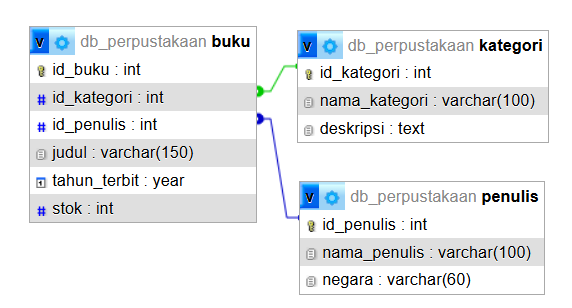

# TP7DPBO2526C1

**TUGAS PRAKTIKUM 7 DPBO — PHP Native OOP GUI**

Vanisha Septiani Auliaputri (2510735)  
Ilmu Komputer C1 — Universitas Pendidikan Indonesia

## JANJI

Saya *Vanisha Septiani Auliaputri* dengan *NIM 2510735* mengerjakan Tugas Praktikum 7 dalam mata kuliah Desain dan Pemrograman Berorientasi Objek untuk keberkahanNya maka saya tidak melakukan kecurangan seperti yang telah dispesifikasikan. Aamiin.

# 📚 Perpustakaan Mini (PHP Native OOP)

Perpustakaan Mini merupakan aplikasi web sederhana untuk mengelola data buku, kategori, dan penulis. Aplikasi menyediakan operasi **Create, Read, Update, dan Delete (CRUD)** pada ketiga entitas melalui halaman yang terpisah.

Aplikasi dibuat menggunakan PHP Native dengan pendekatan Object-Oriented Programming (OOP), serta MySQL sebagai basis data. Tampilan website menggunakan HTML dan CSS tanpa framework PHP.

## Fitur Utama

- **Manajemen Kategori:** menambah, melihat, mengubah, dan menghapus data kategori buku.
- **Manajemen Penulis:** menambah, melihat, mengubah, dan menghapus data penulis.
- **Manajemen Buku:** menambah, melihat, mengubah, dan menghapus data buku.
- **Relasi Database:** data buku terhubung dengan kategori dan penulis melalui Foreign Key.
- **Validasi Input:** memeriksa input wajib, tahun terbit, stok, serta keberadaan kategori dan penulis yang dipilih.
- **Prepared Statement:** operasi database dari PHP menggunakan PDO `prepare()` dan `execute()`.
- **Halaman Terpisah:** Beranda, Buku, Kategori, dan Penulis memiliki tampilan masing-masing.

## Tech Stack

- **Front-End:** HTML, CSS.
- **Back-End:** PHP Native 8.x.
- **Database:** MySQL / MariaDB.
- **Database Access:** PDO (PHP Data Objects).
- **Local Development:** Laragon atau XAMPP.

## Penjelasan Database

Database yang digunakan adalah `db_perpustakaan`. Database ini terdiri dari tiga tabel yang saling berhubungan.

### 1. `kategori`

Tabel `kategori` menyimpan data kelompok atau jenis buku.

| Kolom | Tipe Data | Keterangan |
|---|---|---|
| `id_kategori` | INT | Primary Key, Auto Increment |
| `nama_kategori` | VARCHAR(100) | Nama kategori, wajib diisi |
| `deskripsi` | TEXT | Deskripsi kategori |

### 2. `penulis`

Tabel `penulis` menyimpan informasi penulis buku.

| Kolom | Tipe Data | Keterangan |
|---|---|---|
| `id_penulis` | INT | Primary Key, Auto Increment |
| `nama_penulis` | VARCHAR(100) | Nama penulis, wajib diisi |
| `negara` | VARCHAR(60) | Negara asal penulis |

### 3. `buku`

Tabel `buku` menyimpan data utama buku serta relasinya dengan kategori dan penulis.

| Kolom | Tipe Data | Keterangan |
|---|---|---|
| `id_buku` | INT | Primary Key, Auto Increment |
| `id_kategori` | INT | Foreign Key ke `kategori(id_kategori)` |
| `id_penulis` | INT | Foreign Key ke `penulis(id_penulis)` |
| `judul` | VARCHAR(150) | Judul buku, wajib diisi |
| `tahun_terbit` | YEAR | Tahun terbit, wajib diisi |
| `stok` | INT | Jumlah stok, wajib diisi, nilai awal 0 |

### Relasi dan Constraint

- Satu kategori dapat digunakan oleh banyak buku (one-to-many).
- Satu penulis dapat memiliki banyak buku (one-to-many).
- Setiap data buku harus terhubung dengan satu kategori dan satu penulis.
- `buku.id_kategori` merupakan Foreign Key yang mengacu pada `kategori.id_kategori`.
- `buku.id_penulis` merupakan Foreign Key yang mengacu pada `penulis.id_penulis`.
- **`ON UPDATE CASCADE`** meneruskan perubahan nilai ID pada tabel induk ke Foreign Key di tabel buku.
- **`ON DELETE RESTRICT`** mencegah kategori atau penulis dihapus apabila masih digunakan oleh data buku.

## Skema SQL

Diagram berikut merupakan tampilan relasi tabel `db_perpustakaan` dari phpMyAdmin Designer. Diagram memperlihatkan struktur kolom, Primary Key, Foreign Key, dan hubungan antar tabel.

File SQL untuk membuat database, tabel, constraint, dan data awal tersedia di `program/database/db_perpustakaan.sql`.

## Alur Aplikasi

### 1. Entry Point

**File:** `index.php`

`index.php` menjadi titik masuk aplikasi yang menangani request dari browser, membuat object, memproses aksi CRUD, dan memanggil halaman tampilan yang sesuai.

### 2. Database Connection

**File:** `config/database.php`  
**Class:** `Database`

Class `Database` membuat koneksi ke MySQL menggunakan PDO. Method `getConnection()` menyediakan object koneksi yang digunakan oleh class entitas.

### 3. Model Classes

Setiap tabel memiliki class tersendiri di folder `class/`.

#### Class `Kategori`

**File:** `class/Kategori.php`

- `getAll()`: mengambil seluruh data kategori.
- `getById($id)`: mengambil kategori berdasarkan ID.
- `create($nama, $deskripsi)`: menambahkan kategori.
- `update($id, $nama, $deskripsi)`: mengubah kategori.
- `delete($id)`: menghapus kategori.

#### Class `Penulis`

**File:** `class/Penulis.php`

- `getAll()`: mengambil seluruh data penulis.
- `getById($id)`: mengambil penulis berdasarkan ID.
- `create($nama, $negara)`: menambahkan penulis.
- `update($id, $nama, $negara)`: mengubah penulis.
- `delete($id)`: menghapus penulis.

#### Class `Buku`

**File:** `class/Buku.php`

- `getAll()`: mengambil data buku beserta nama kategori dan penulis menggunakan `INNER JOIN`.
- `getById($id)`: mengambil buku berdasarkan ID.
- `create(...)`: menambahkan buku beserta relasi kategori dan penulis.
- `update(...)`: mengubah data buku.
- `delete($id)`: menghapus buku.

### 4. View

Folder `view/` berisi tampilan yang dipanggil oleh `index.php`.

- `beranda.php`: halaman awal aplikasi.
- `buku.php`: halaman CRUD buku.
- `kategori.php`: halaman CRUD kategori.
- `penulis.php`: halaman CRUD penulis.
- `header.php` dan `footer.php`: bagian tampilan yang digunakan bersama.

### 5. Prepared Statement

Query database yang dijalankan dari PHP menggunakan PDO prepared statement. Nilai input dikirim melalui `execute()` secara terpisah dari teks query. Dengan demikian, input pengguna tidak digabungkan langsung ke dalam string SQL.

## 🚀 Cara Menjalankan Program

1. Pastikan Laragon atau XAMPP sudah terpasang.
2. Salin folder `program` ke direktori web server:
   - Laragon: `C:\laragon\www\TP7DPBO2526C1`
   - XAMPP: `C:\xampp\htdocs\TP7DPBO2526C1`
3. Jalankan Apache dan MySQL.
4. Buka HeidiSQL atau phpMyAdmin, lalu import file `program/database/db_perpustakaan.sql`.
5. Periksa konfigurasi pada `program/config/database.php`. Konfigurasi awal menggunakan host `localhost`, database `db_perpustakaan`, username `root`, dan password kosong.
6. Buka `http://localhost/TP7DPBO2526C1/` melalui browser.

**Catatan:** file SQL menggunakan `DROP TABLE IF EXISTS` sebelum membuat ulang tabel. Mengimpor ulang file tersebut akan menghapus data yang sudah ada pada tabel project dan menggantinya dengan data awal.

## Demo

### Demo Penggunaan

Video ini memperlihatkan penggunaan aplikasi dan pengujian operasi CRUD pada halaman yang tersedia.

https://github.com/user-attachments/assets/7d096fc6-e17e-477d-a59d-6ebb59b49ef3

### Tampilan Database

Video ini memperlihatkan database `db_perpustakaan`, tabel-tabel yang digunakan, isi data, dan struktur relasinya melalui HeidiSQL.

https://github.com/user-attachments/assets/14a1d964-5f0d-430a-b900-a4cd57d1695d

